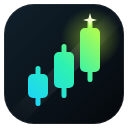

# Priism Skins for TradingView



Live backgrounds (animated skins, images, GIFs, video) behind TradingView charts.
Purely cosmetic. It does not read orders, positions or account data and makes no network requests.

## Try it
1. Open `chrome://extensions`, enable **Developer mode**.
2. **Load unpacked** and select this `wicked-skins/` folder.
3. Open a TradingView chart and click the Priism Skins icon.

## Layout
- `src/skins.js`: built-in canvas skins. Add one by adding a factory to `window.WickedSkins`.
- `src/content.js`: builds the background layer and applies settings live.
- `src/content.css`: makes the chart transparent. **If TradingView changes its markup, fix selectors here.**
- `popup/`: skin picker, custom media upload, darken/blur/FPS.

## Works on other platforms (TopstepX and other prop-firm platforms)
Many platforms embed TradingView's charting library (e.g. [TopstepX](https://help.topstepx.com/components/tradingview-tm-charts)).
Open the platform's chart, click the Priism Skins icon. If a chart is found you'll see **"Chart found on …" → Turn on here**.
Chrome asks once for that site; the page reloads skinned. **Turn off** in the same place removes it (and the permission).
It only switches on inside the frame that contains the chart; the rest of the platform is untouched.
On platforms without TradingView's internal API, candle colours are learned from what's drawn.

## Multi-chart layouts
Adjust → **Multiple charts**: **Stretch** (one wallpaper across the layout), **Each chart** (a copy per chart) or
**Mix** (a different skin per chart). In Mix, pick **Chart 1 / Chart 2…** at the top of the Skins or Uploads tab, then
click a skin. Charts are numbered top-left first, row by row; **Show chart numbers** flashes them on the page.
Candle colours, glow and price-scale styling apply to every chart. Works when the charts sit in one page or in
iframes (prop platforms): the top page numbers charts across frames. Tested with 1, 2 and 4 charts on TradingView's
Trading Platform demo (the same charting library prop platforms use).

## Website, store and Workshop
- Website (`site/`): home, Workshop, Privacy, Terms; deployed to GitHub Pages by `.github/workflows/pages.yml`.
- Chrome Web Store: see **[STORE.md](STORE.md)** (listing text, images in `store/`, permission justifications).
- Workshop (community wallpapers on Supabase): see **[WORKSHOP.md](WORKSHOP.md)**.

## Updates
Buyers get updates automatically (Chrome Web Store, desktop auto-updater, or an in-panel banner for zip installs).
See **[RELEASING.md](RELEASING.md)**: one command + a tag push publishes everywhere.

## Features
- **One-click looks**: complete combos (skin + candles + glow + price scale) in one tap, with **Undo**.
- **Candle styles**: Solid, Tube (glowing outlines), Rainbow (colours across the chart), Cycle (colours flow over time).
- **Glow**: candles, plus indicators / drawings / price & position lines / the P&L pill. Grid and crosshair never glow.
- **Price scale**: custom text colour, glow, bold, backing (Auto / Clear / Glass / TradingView), price tags in candle colours.
- **Auto readability**: scale and legend text switch light/dark per label from the brightness behind it (videos too).
- **Alt+Shift+W** on the chart: everything on/off.
- **Candles**: recolour up/down candles and volume (18 presets or custom colours; works with your own TradingView colours and candle/hollow/Heikin Ashi/bar styles) with optional glow. Changes apply live.
- **Skins**: 46 live wallpapers in 8 categories (Nature, Space, Warm, Neon, City, Calm, Weather, Trading).
- **Uploads**: your own images/GIFs/videos, **almost any video**. Ones the browser
  can't play are converted to WebM on your computer (ffmpeg.wasm, see `vendor/ffmpeg/NOTICE.md`).
  Files are stored in the extension's own database (up to 2 GB each) and played by `player/player.html`.
  Adding files opens a full-tab manager so long conversions aren't interrupted. Drag & drop supported.
- **Live mood** (Adjust → Motion & mood):
  - *Price*: the chart edges glow green or red with the day's move and pulse on price ticks, and skins speed up when price moves.
    Price comes from the tab title TradingView already shows.
  - *Position*: glows with your P&L from an entry price **you type in** (long/short, optional symbol). Worked out locally;
    it never reads your account, orders or positions.
- **Watermark** (Adjust → Watermark): your own text and/or logo on the chart (on/off switch, 5 positions, size, opacity, colour).
  It sits on top of the chart so it shows in screen recordings and screenshots of your screen; it never blocks clicks.
  (TradingView's own camera snapshot is rendered by TradingView and won't include it.)
- **Adjust**: opacity, on-top strength, darken, blur, saturation, hue, speed, position, fit, FPS, eco mode, layer.
- **Saved**: save/apply/export/import your looks.

## Roadmap
1. Skin format: a skin pack is JSON `{ id, name, type, ...}` so it can be exported/imported and shared.
2. Workshop: backend (auth, uploads, moderation queue, likes, report/DMCA flow) plus an in-extension browser.
3. Pro tier: license keys, device limits, subscriptions (Stripe or Whop).
4. Desktop app (Electron / TradingView Desktop injection) and Safari port.
5. Ideas to beat the competition: per-layout skins, price-reactive effects (glow on up/down candles), scheduled skins, performance auto-throttle.

## Desktop app (Windows / macOS / Linux)
```
cd desktop && npm install && npm start
```
Opens TradingView in its own window with the same engine and settings UI (Ctrl/Cmd+, reopens settings).
Settings are saved in the app's user-data folder. Package with `electron-builder` when ready.
Note: this wraps tradingview.com; it does not modify the official TradingView Desktop install.

## Mobile (planned)
- **iOS / iPadOS / macOS Safari**: Safari Web Extension. Xcode can convert this folder
  (`xcrun safari-web-extension-converter wicked-skins/`). Needs an Apple Developer account.
- **Android (phones + tablets)**: a native WebView app lives in **[`android/`](android/)**. It loads
  tradingview.com and injects the same `src/` code as the desktop app, with the shared `popup/` as a settings
  sheet. Build it in Android Studio (`./gradlew assembleRelease`); see `android/README.md`. The official
  TradingView Android app can't run add-ons, so this shell is how mobile gets skins.
- The official TradingView mobile apps cannot be modified, so mobile means web-in-browser or our own wrapper app.

## Logo
`icons/logo.svg` (full) and `icons/logo-small.svg` (simplified, used for 16/32 px) are the sources.
PNG sizes 16/32/48/128/512 are rendered from them. If the name changes, only the popup label and these files need updating.
